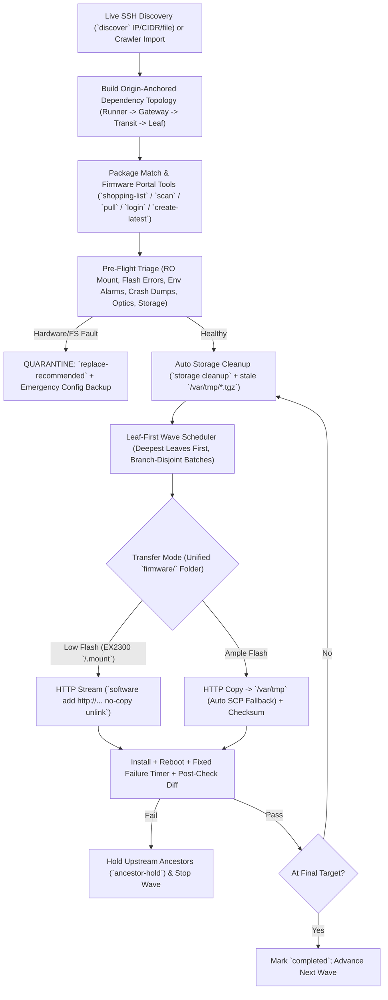

# Junos Switch Upgrader

Site-generic, topology-aware Juniper Networks (`EX2300`, `EX3400`, `EX4100`, `EX4300-48MP`, `EX4300`, `EX4400`, `EX4600`, `EX4650`, `QFX5120`, `QFX5200`) firmware upgrade orchestrator with unified HTTP + SCP hosting, live dependency visualization, package architecture validation, and hardware/filesystem triage.

## License

Licensed under **GNU AGPLv3** (`AGPL-3.0-or-later`). See [LICENSE](LICENSE).

## Architecture & Control Flow



## Key Features

- **Site-Generic Live Discovery (`discover`)**: Probe any IP, hostname, CIDR subnet, or host list over SSH (`--credentials-file` supports [net-docu-crawler](https://github.com/leifdavisson/net-docu-crawler) JSON credential lists; see [credentials.example.json](credentials.example.json)) to auto-detect model, serial, running Junos version, kernel architecture, `/.mount` free flash, LLDP neighbors, and STP Root Ports.
- **Unified Single-Folder HTTP + SCP Server**: Serves `firmware/` over HTTP (using per-session URL tokens) for `EX2300` `no-copy unlink` streaming and fast `/var/tmp` pulls, seamlessly falling back to direct SCP push from the **exact same folder** if switch-to-runner HTTP is firewalled—while hosting the live dark-mode SVG topology dashboard on loopback `/`.
- **Daisy-Chain Protection**: Orders upgrades strictly **leaf-first** (`Depth N` -> `Depth N-1`), isolates `Core` switches behind `--include-cores`, prevents pairing upstream/downstream switches in the same batch, and automatically marks upstream ancestors `ancestor-hold` if a downstream device fails.
- **4-Way Switch-to-Package Validation**: Distinguishes multi-gig `-MP` VMHost images (`ex4300-48mp` vs `ex4300` PowerPC), ARM-32 (`ex2300`/`ex3400`), ARM-64 (`ex4100`), x86-64 (`ex4400`), and `Junos OS Evolved` vs classical `jinstall-host` before any file is transferred. Placeholder checksums hard-stop by default unless real hashes are populated (e.g., via `firmware scan`) or `--allow-unverified-checksums` is explicitly supplied.
- **Replace-vs-Upgrade Triage Floor**: Detects read-only mounts, flash/MMC syslog I/O errors, fan/thermal/PSU faults, `/var/crash` core dumps, active uplink optical power alarms, and unrecoverable storage exhaustion—quarantining unsafe hardware (`replace-recommended`) and immediately exporting emergency backups.
- **3-Layer Pluggable Core (`drivers/` + FSM + Topology Scheduler)**: Separates the vendor-neutral [SwitchDriver](src/junos_upgrader/drivers/base.py) protocol ([JunosSwitchDriver](src/junos_upgrader/drivers/junos.py)) from the thread-safe persisted finite state machine (`ready` → `staged` → `downloaded` → `installing` → `rebooting` → `validated` → `completed`).
- **Two-Phase Staging & Fast Intermediate Hops**: Run `junos-upgrader stage` during business hours to copy and verify `/var/tmp` packages without rebooting; during `upgrade`, pre-staged packages are reused without re-transferring, intermediate hops run fast 11-command delta checks (full 28-command baselines on Hop 1 Pre & Final Post), and a configurable `--post-settle-seconds` (default `60s`) verifies PoE power delivery, MAC repopulation, and LACP bundles post-reboot.
- **Recovery Cheat-Sheets & Console Gate**: After passing prechecks, `precheck`, `stage`, and `upgrade` generate `deliverables/configs/<site>/<hostname>/recovery.txt` with exact management IP, netmask, gateway, OAM snapshot version, and loader/USB recovery commands (skipped if identity/precheck fails before baseline capture); `Core` switches require a `console_port` unless `--allow-no-console` is explicitly supplied.
- **Cross-Train Config Landmines & Snapshot Refresh**: Scans candidate configs for deprecated SSH crypto, legacy `ethernet-switching-options`, and plaintext telnet; optionally refreshes the OAM/VMHost recovery snapshot after the final hop (`--refresh-snapshot`).
- **Firmware Portal Helper (`firmware`)**: Generates a deduplicated Juniper Support Portal shopping list (`shopping-list`), opens a visible browser session (`login`), downloads signed HTTPS CDN URLs (`pull`), scans/validates `.tgz` archives (`scan`) updating manifest checksums, and builds optional non-JTAC bleeding-edge manifests (`create-latest`, guarded by `--accept-bleeding-edge`).

## Companion Tool: `net-docu-crawler`

`junos-switch-upgrader` is designed to pair seamlessly with [**net-docu-crawler**](https://github.com/leifdavisson/net-docu-crawler) for end-to-end discovery-to-upgrade workflows:

1. **Discover & Document with `net-docu-crawler`**: Crawl your campus or IDF network to produce `asset_inventory.csv`, `02_normalized/neighbors.csv`, and a `credentials.json` credential list.
2. **Import into `junos-switch-upgrader`**: Run `junos-upgrader init-from-crawler /path/to/crawler_deliverables` to filter switch assets, map LLDP neighbor expectations from `02_normalized/neighbors.csv`, resolve per-platform multi-hop upgrade paths, and write `deliverables/site-inventory.json`.
3. **Reuse Credentials & Verify Topology**: Pass the same `--credentials-file credentials.json` to `precheck`, `stage`, and `upgrade`, and run `junos-upgrader topology` to confirm leaf-first upgrade waves match your crawled network graph.

## Operational Security & Data Isolation (`deliverables/`)

All site-proprietary and operator-proprietary data—switch inventories, management IPs, serial numbers, pre/post configurations, CLI baseline evidence, site topology diagrams, firmware binaries, and credentials—belongs inside the gitignored `deliverables/`, `firmware/`, and `credentials.json` paths (configured in [.gitignore](.gitignore)).

- Default CLI outputs write directly to `deliverables/site-inventory.json`, `deliverables/evidence/`, and `deliverables/configs/`.
- Prefer `--credentials-file credentials.json`, `JUNOS_PASSWORD`, or `--password-stdin` over passing `--password` on the command line (CLI arguments appear in process tables and shell history).
- **HTTP Server Bind & UI Exposure**:
  - `junos-upgrader topology --serve` binds to `127.0.0.1` by default (override with `--bind-host`). Passing `--redact --serve` serves redacted hostnames and RFC 5737 IPs on `/api/topology`.
  - `stage` and `upgrade` bind the unified HTTP firmware server to `0.0.0.0` by default (override with `--bind-host`) so switches can fetch packages over HTTP; `/` and `/api/topology` remain restricted to loopback clients, `/firmware/` requires a per-session token, and the HTTP server is skipped completely for `--transfer-mode scp` and `--dry-run`.
- Use `junos-upgrader topology --manifest deliverables/site-inventory.json --redact --markdown deliverables/topology_redacted.md` when sharing sanitized topology graphs externally without exposing real hostnames or IP addresses.
- Never commit `credentials.json`, `deliverables/`, or `firmware/**/*.tgz` to version control.

## Quick Start

### Windows Setup

Requires Python `>=3.10` (`setup-windows.ps1` prefers Python 3.12 for prebuilt wheels while supporting 3.10–3.14).

```powershell
# Assess environment (read-only)
powershell -ExecutionPolicy Bypass -File .\setup-windows.ps1

# Install/repair Python, VC++ Redistributable, .venv, and optional scoped inbound HTTP firewall rule
powershell -ExecutionPolicy Bypass -File .\setup-windows.ps1 -Fix -FirewallRule
```

### Linux / macOS & CLI Usage

```bash
git clone https://github.com/leifdavisson/junos-switch-upgrader.git
cd junos-switch-upgrader
python3 -m venv .venv
source .venv/bin/activate
pip install -e ".[dev]"
cp credentials.example.json credentials.json
# Edit credentials.json with real SSH credentials (never leave "CHANGE_ME")

# 0. Optional: scaffold firmware directory layout or import from net-docu-crawler
junos-upgrader init-repo .
# junos-upgrader init-from-crawler /path/to/crawler_deliverables

# 1. Discover switches live via SSH (RFC 5737 documentation IP example)
junos-upgrader discover --target 192.0.2.10 --credentials-file credentials.json

# 2. Inspect inventory status, multi-hop plan, and dependency topology
junos-upgrader status
junos-upgrader plan
junos-upgrader topology --markdown deliverables/topology.md
junos-upgrader topology --serve --port 8080          # binds 127.0.0.1 by default

# 3. Generate firmware shopping list & ingest downloaded .tgz packages (populates real MD5s)
junos-upgrader firmware shopping-list
junos-upgrader firmware scan ~/Downloads --firmware-dir firmware
# Also available: `firmware login`, `firmware pull --url <https-url>`, `firmware create-latest`

# 4. Run live read-only precheck, landmine scan, triage & recovery.txt export
junos-upgrader precheck --credentials-file credentials.json --skip-release-notes-gate

# 5. Optional two-phase business-hours staging (copies & checksums without reboot)
junos-upgrader stage --credentials-file credentials.json --skip-release-notes-gate

# 6. Run live SSH dry-run (triage, cleanup preview & config backup; stops before install/reboot)
junos-upgrader upgrade --credentials-file credentials.json \
  --change-number CHG001 --operator netops --skip-release-notes-gate --dry-run

# 7. Before maintenance-window upgrade:
#    - Populate real package checksums via `firmware scan` (or explicitly pass `--allow-unverified-checksums` only in a lab).
#    - Review Juniper release notes for each hop and set `release_notes_reviewed: true` in manifests/approved-releases.yml
#      (or pass `--skip-release-notes-gate` after manual review).
#    - For non-JTAC manifests built with `firmware create-latest`, also pass `--accept-bleeding-edge`.
junos-upgrader upgrade --credentials-file credentials.json \
  --change-number CHG001 --operator netops --refresh-snapshot
```

## CLI Command Reference

| Command | Purpose |
| --- | --- |
| `init-repo <dir>` | Scaffold `firmware/`, `manifests/`, and `deliverables/` directory tree |
| `init-from-crawler <dir>` | Import `net-docu-crawler` `asset_inventory.csv` and `neighbors.csv` into a site manifest |
| `discover` | Live SSH discovery from IPs, hostnames, CIDRs, or `--targets-file` |
| `status` | Display current inventory table, depth, triage verdict, and FSM state |
| `plan` | Show per-switch remaining multi-hop upgrade path |
| `topology` | Render Rich tree, leaf-first waves, Mermaid `--markdown`, or loopback `--serve` dashboard (`--redact`, `--write-manifest`) |
| `firmware shopping-list` | Deduplicated table of required firmware packages across eligible switches |
| `firmware scan <dir>` | Validate `.tgz` archives, copy into `firmware/`, and update manifest checksums |
| `firmware pull` | Download signed HTTPS firmware URLs, validate, and ingest |
| `firmware login` | Open Juniper Support Portal in browser and watch `--watch-dir` for downloads |
| `firmware create-latest` | Build a separate non-JTAC bleeding-edge release manifest from newer local `.tgz` images |
| `precheck` | Live read-only health/FS triage, landmine scan, config backup, and `recovery.txt` export |
| `stage` | Two-phase business-hours staging (transfer & verify checksum without reboot) |
| `upgrade` | Leaf-first multi-hop upgrade orchestration with reboot polling, post-checks, and ancestor holds |

## Dependencies & Attribution

- [Netmiko](https://github.com/ktbyers/netmiko) — Multi-vendor SSH & SCP automation library ([docs](https://ktbyers.github.io/netmiko/))
- [Paramiko](https://github.com/paramiko/paramiko) — Python SSHv2 protocol implementation ([homepage](https://www.paramiko.org/))
- [Click](https://github.com/pallets/click) — Composable Python CLI framework ([docs](https://click.palletsprojects.com/))
- [PyYAML](https://github.com/yaml/pyyaml) — YAML release manifest parser ([homepage](https://pyyaml.org/))
- [Rich](https://github.com/Textualize/rich) — Terminal dependency trees and status tables ([docs](https://rich.readthedocs.io/))
- [net-docu-crawler](https://github.com/leifdavisson/net-docu-crawler) — Optional campus discovery & credential format compatibility
- [Juniper Junos OS Documentation](https://www.juniper.net/documentation/product/us/en/junos-os/) — Official Junos OS upgrade and platform software references
