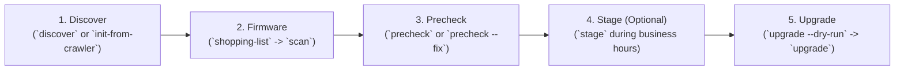

# Junos Switch Upgrader — Operator Guide

> **Audience:** Junior and mid-level network engineers running Juniper EX/QFX upgrades with `junos-switch-upgrader`.  
> **Goal:** Walk you through the normal workflow, explain *why* each flag exists, and show you how to handle the most common real-world situations without locking yourself out of a switch.

Back to [README.md](../README.md) · Licensed under **GNU AGPLv3** ([LICENSE](../LICENSE)).

---

## 1. The Big Picture (5-Step Workflow)

Every upgrade follows the same safe, repeatable sequence. You never jump straight to rebooting switches:



| Step | Command | Modifies Switch? | Reboots Switch? | When to Run |
| --- | --- | --- | --- | --- |
| **1. Discover** | `discover` / `init-from-crawler` | No (read-only) | No | Anytime |
| **2. Firmware** | `firmware shopping-list` / `scan` | No (local only) | No | Anytime |
| **3. Precheck** | `precheck` | No (read-only) | No | Business hours |
| **3b. Remediate** | `precheck --fix` | Safe cleanup / rescue save only | No | Business hours |
| **4. Stage** | `stage` | Copies `.tgz` + verifies MD5 | No | Business hours |
| **5a. Dry-Run** | `upgrade --dry-run` | No (read-only) | No | Before window |
| **5b. Upgrade** | `upgrade` | Installs + reboots + verifies | **Yes** | Maintenance window |

---

## 2. Handling Passwords & Credentials Safely

Never type `--password MySecretPassword` directly on the command line in production. Why?
1. **Shell history:** Bash, Zsh, and PowerShell save commands to history files on disk (`~/.bash_history`, `ConsoleHost_history.txt`), where anyone with access to the jumpbox can read your password later.
2. **Process lists:** Command-line arguments are visible to other users/monitoring tools via `ps aux` or Task Manager while the command runs.
3. **Screen sharing / screenshots:** It stays in your terminal scrollback.

### Recommended Pattern A: Hidden Prompt → Environment Variable (Linux / macOS)

For one-off sessions or lab tests where you don't want to put a password in a file:

```bash
# 1. Prompt without echoing characters (-s), then export for this shell session only
read -s -p "Root password: " JUNOS_PASSWORD; echo; export JUNOS_PASSWORD

# 2. Run your junos-upgrader commands (it reads JUNOS_PASSWORD automatically)
junos-upgrader precheck --username root --manifest deliverables/site-inventory.json

# 3. Clear the password from memory as soon as you're done
unset JUNOS_PASSWORD
```

- `read -s -p "..." JUNOS_PASSWORD` reads your password silently so it never appears on screen or in `.bash_history`.
- `export JUNOS_PASSWORD` makes it available to `junos-upgrader` in the current terminal without passing it as a CLI argument.
- `unset JUNOS_PASSWORD` wipes it from the shell environment when you finish.

### Recommended Pattern B: Hidden Prompt → Environment Variable (Windows PowerShell)

```powershell
# 1. Prompt securely in Windows and store only in this PowerShell session
$cred = Get-Credential -UserName root -Message "Junos SSH password"
$env:JUNOS_PASSWORD = $cred.GetNetworkCredential().Password

# 2. Run your commands
.\.venv\Scripts\junos-upgrader.exe precheck --username root --manifest deliverables/site-inventory.json

# 3. Clear from session when done
Remove-Item Env:JUNOS_PASSWORD
```

### Recommended Pattern C: `credentials.json` + `ssh-agent` (Multi-Switch Sites)

For recurring campus runs, copy [credentials.example.json](../credentials.example.json) to `credentials.json` (which is gitignored) and pass `--credentials-file credentials.json`.
- If you use a **passphrase-protected SSH key** (`~/.ssh/id_ed25519`), unlock it once in `ssh-agent` (`eval "$(ssh-agent -s)" && ssh-add ~/.ssh/id_ed25519`). `junos-upgrader` automatically falls back to `ssh-agent` when the key file on disk is encrypted.

---

## 3. Common Real-World Scenarios

### Scenario 1: Your First Single-Switch Canary Test
Always test on **one non-critical leaf switch** (an access switch with no downstream switches) before touching a whole building.

```bash
# 1. Discover just one switch (RFC 5737 documentation IP example)
junos-upgrader discover --target 192.0.2.10 --site CAMPUS --credentials-file credentials.json

# 2. Review its multi-hop plan and required .tgz files
junos-upgrader plan
junos-upgrader firmware shopping-list

# 3. Ingest downloaded .tgz packages (copies into firmware/ and records real MD5s)
junos-upgrader firmware scan ~/Downloads --firmware-dir firmware

# 4. Run read-only precheck
junos-upgrader precheck --credentials-file credentials.json

# 5. Run live dry-run (verifies everything except install/reboot)
junos-upgrader upgrade --dry-run --credentials-file credentials.json \
  --change-number CHG001-TEST --operator netops --max-hops 1

# 6. Maintenance window: upgrade 1 switch, 1 hop first
junos-upgrader upgrade --credentials-file credentials.json \
  --change-number CHG001 --operator netops --batch-size 1 --max-hops 1
```

Once Hop 1 succeeds and you've checked the evidence in `deliverables/evidence/`, remove `--max-hops 1` and add `--refresh-snapshot` to finish the remaining hops and update the switch's OAM recovery snapshot.

---

### Scenario 2: Downloading the Right Files from the Juniper Support Portal
When downloading from the [Juniper Support Portal](https://support.juniper.net/support/downloads/):
- **OS Dropdown:** Look under **`Junos SR`** (Service Releases, where most JTAC-recommended `-S` builds live) or **`Junos`**.
- **Section:** Download the **Install Package** (`.tgz`, e.g., `junos-arm-32-*.tgz` for EX2300/EX3400, `junos-install-ex-arm-64-*.tgz` for EX4100, `jinstall-host-ex-4600-*-signed.tgz` for EX4600).
- **Do NOT download:**
  - **Install Media** (`.gz` / `.img.gz` USB recovery images — `firmware scan` will reject them).
  - **J-Web** (`jweb-ex-*.tgz` — optional web GUI, wastes flash space on EX switches).
- **Older trains missing from the portal?** Juniper prunes End-of-Support trains (like `18.4`, `19.3`, `21.2`) from the dropdown. Either open a JTAC case with your switch serial numbers to request archived `.tgz` links, or update the platform's `hops` in [manifests/approved-releases.yml](../manifests/approved-releases.yml) (remembering `no-validate` when crossing the `21.2` FreeBSD 10→12 boundary) and re-run `firmware scan`.

---

### Scenario 3: Low Flash or Missing Rescue Config (`precheck --fix`)
EX2300 and EX3400 switches have a tight **1.3 GB `/.mount`** flash partition. It is very common for `precheck` to flag:
- `Minor: Rescue configuration is not set` (warning)
- Stale logs or old `.tgz` files in `/var/tmp`

Instead of SSHing into every switch manually, run **`precheck --fix`**:

```bash
junos-upgrader precheck --fix --credentials-file credentials.json
```

What `precheck --fix` does (safely, **without rebooting**):
1. Runs `request system storage cleanup no-confirm` and deletes stale `/var/tmp/*.tgz` files (while protecting any matching pre-staged package).
2. Saves the rescue config (`request system configuration rescue save`) if unset.
3. Re-runs triage in-place and updates your manifest.

**How `/tmp` (`tmpfs`) protects EX2300/EX3400 automatically:**  
Even after cleanup, an EX3400 often has ~400–700 MB free on `/.mount`, while `/.mount/tmp` (`/tmp`) is a **RAM disk (`tmpfs`)** with 500–900 MB free. During `stage`/`upgrade`, `junos-upgrader` automatically detects `tmpfs` headroom and stages the `.tgz` into `/tmp/` (with `no-copy unlink`) so `/.mount` keeps its full free space for unpacking.

**If `/.mount` is still below the floor and you are logged in as `root`:**  
Add `--purge-previous-pkg` alongside `--fix` to run `pkg setop rm previous` + `pkg delete old` (note: this requires root shell privileges and removes rollback to the previous Junos version).

---

### Scenario 4: RADIUS/TACACS+-Only Switches (`--create-fallback-user`)
If a switch uses `authentication-order radius` (or `tacplus`) and has **no local `super-user` account with a password or SSH key** (only a template user like `remote`), a RADIUS/uplink hiccup after a major upgrade can lock out remote SSH management until someone walks over with a serial console cable.

By default, `junos-upgrader` **hard-stops** on AAA-only switches. You have two explicit choices:

1. **Recommended — Create a local SSH fallback `super-user` with explicit approval:**
   ```bash
   # Prompts for a hidden password (or pass --fallback-ssh-key ~/.ssh/id_ed25519.pub)
   # and displays an interactive [y/N] confirmation panel before committing anything:
   junos-upgrader precheck --fix --create-fallback-user localadmin \
     --credentials-file credentials.json
   ```
   - Only touches switches that actually fail `local_ssh_fallback` and have a clean commit state.
   - Uses `configure exclusive` → `commit check` (auto-rolls back on any error) → `commit` → `request system configuration rescue save`.

2. **Override (only if you have verified out-of-band console access):**
   Pass `--allow-aaa-only-ssh` to `precheck`, `stage`, or `upgrade`.

---

### Scenario 5: Resetting a Switch After Fixing a Blocker (`reset-state`)
If a switch was marked `failed`, `replace-recommended`, `ancestor-hold`, or `staged` and you have fixed the underlying issue (e.g., freed storage or updated `approved-releases.yml`), you don't need to re-run `discover` or edit JSON by hand:

```bash
# Reset one switch (or omit --host to reset all failed/held/quarantined switches)
junos-upgrader reset-state --host IDF-SW-01 --manifest deliverables/site-inventory.json
```
*(Switches marked `excluded`, such as non-Juniper HP/ProCurve gear, are never reset.)*

---

### Scenario 6: Business-Hours Staging & Campus Rollout
When upgrading a multi-switch building or campus:
1. **Import full topology** from [net-docu-crawler](https://github.com/leifdavisson/net-docu-crawler) (`init-from-crawler`) or `discover --target 192.0.2.0/24`.
2. **Visualize the upgrade waves** before touching anything:
   ```bash
   junos-upgrader topology --markdown deliverables/topology.md
   junos-upgrader topology --serve --port 8080   # dark-mode SVG map on http://127.0.0.1:8080/
   ```
   `junos-upgrader` always upgrades **deepest leaves first** so you never reboot an upstream switch while downstream switches are upgrading. If a switch fails, its upstream ancestors are automatically placed in `ancestor-hold`.
3. **Stage during business hours** (copies `.tgz` & checks MD5, zero downtime):
   ```bash
   junos-upgrader stage --credentials-file credentials.json
   ```
4. **Upgrade in the maintenance window** (start with `--batch-size 1` or `2`):
   ```bash
   junos-upgrader upgrade --credentials-file credentials.json \
     --change-number CHG002 --operator netops --batch-size 2 --refresh-snapshot
   ```
5. **Core switches last:** Switches with `role: Core` are skipped by default. Only upgrade them once access switches are healthy, with `--include-cores` and a documented `console_port` (or `--allow-no-console` if local console is physically on-site).

---

### Scenario 7: Troubleshooting & Gathering Logs
If something fails, re-run with `-v` / `--verbose` and `--log-file`:

```bash
junos-upgrader --verbose --log-file deliverables/debug.log precheck \
  --host IDF-SW-01 --credentials-file credentials.json
```

Key files to inspect:
- `deliverables/site-inventory.json` — `state`, `triage_verdict`, `triage_reasons`, and `last_error`.
- `deliverables/evidence/<site>/<change>/<hostname>/<hop>/pre/` and `post/` — raw Junos CLI captures (`show_system_storage.txt`, `config_landmines.txt`, `config_diff.txt`, `show_poe_controller.txt`).
- `deliverables/configs/<site>/<hostname>/recovery.txt` — exact IP, netmask, gateway, OAM snapshot version, and loader/USB recovery steps.

---

## 4. Quick Flag Cheat-Sheet

| Flag | Commands | When to Use It |
| --- | --- | --- |
| `--verbose` / `-v`, `--log-file <path>` | Global (before subcommand) | Troubleshooting SSH, discovery, or transfer issues |
| `--fix` | `precheck` | Safely clean storage & save rescue config without rebooting |
| `--create-fallback-user <user>` | `precheck --fix` | Explicitly add a local `super-user` SSH fallback on AAA-only switches (requires `[y/N]` approval) |
| `--fallback-ssh-key <file.pub>` | `precheck --fix` | Use an SSH public key instead of a password for `--create-fallback-user` |
| `--purge-previous-pkg` | `precheck --fix` | Purge `/packages/sets/previous` on EX2300/EX3400 when `/.mount` is still below floor (requires root shell) |
| `--allow-aaa-only-ssh` | `precheck`, `stage`, `upgrade` | Override the AAA-only SSH lockout gate when OOB console is verified |
| `--skip-release-notes-gate` | `precheck`, `stage`, `upgrade` | Bypass `release_notes_reviewed: false` after manual release-notes review |
| `--allow-unverified-checksums` | `precheck`, `stage`, `upgrade` | **Lab only** — allow placeholder checksums before running `firmware scan` |
| `--dry-run` | `upgrade` | Full live SSH precheck + backup without installing or rebooting |
| `--max-hops 1` | `upgrade` | Limit to 1 hop at a time (ideal for your first canary switch) |
| `--batch-size N` | `stage`, `upgrade` | Parallel branch-disjoint switches per wave (start with `1` or `2`) |
| `--refresh-snapshot` | `upgrade` | Refresh OAM/VMHost recovery snapshot after reaching the final target |
| `--include-cores` | `stage`, `upgrade` | Include `Core` role switches (excluded by default for safety) |

---

## References
- [Juniper Junos OS Documentation](https://www.juniper.net/documentation/product/us/en/junos-os/)
- [net-docu-crawler](https://github.com/leifdavisson/net-docu-crawler)
- [Netmiko](https://github.com/ktbyers/netmiko) · [Paramiko](https://github.com/paramiko/paramiko)
